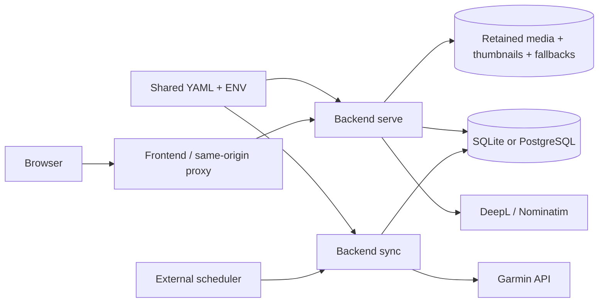

# go-garmindives specification

This is the product and implementation specification for a personal, bilingual
diving logbook. It is intended both for an agent building the frontend and for an
engineer implementing a compatible backend in another language.

Baseline: backend commit `54aefed`, SQL schema **11**, application configuration
version **1**, decoded FIT document version **1**, photo processing profile **1**, HTTP API `/api/v1`.
These documents describe implemented behavior, not a proposed roadmap.

## Reading paths

| Reader | Read in this order |
| --- | --- |
| Frontend developer / agent | [Product](docs/specs/product.md), [frontend integration](docs/specs/frontend.md), [API map](docs/specs/api-map.md), relevant schemas in [OpenAPI](docs/openapi.yaml) |
| Backend reimplementation / Rust port | Product, [backend algorithms](docs/specs/backend.md), [storage](docs/specs/storage.md), [configuration and security](docs/specs/configuration-security.md), [operations](docs/specs/operations.md), [acceptance scenarios](docs/specs/acceptance.md), OpenAPI |
| Operator | [Operations](docs/specs/operations.md), configuration and security, [README](README.md) command examples |

For source navigation and package responsibilities, see
[repository organization](docs/specs/repository.md).

The specification is a package. Prose defines concepts, ownership, algorithms,
and lifecycle; OpenAPI defines the exact HTTP field names, nullability, enums,
parameters, response envelopes, and status codes. [schema.sqlite.sql](docs/specs/schema.sqlite.sql)
records the complete physical database shape. [countries.json](docs/specs/countries.json)
records the supported country codes and French/English display names.

The implementation and its tests supplied the evidence for this baseline. If a
future code change contradicts these documents, update the affected specification,
OpenAPI, and acceptance examples in the same change; do not silently reinterpret
the contract. Illustrative JSON snippets are partial unless explicitly called a
complete request. Never infer a new endpoint from an example screen.

## System purpose

The owner imports their Garmin dives, keeps the source measurements and original
FIT files, adds photos/videos and descriptions, organizes travel, and publishes
a read-only logbook. French is the editorial source language; English is provided
by generated country/trip names and cached translations. One local administrator
controls edits. Visitors need no account after initial setup.

The planned four-container deployment is frontend, serve backend, sync backend,
and PostgreSQL. SQLite is also supported and is the default. The two backend
roles are commands of the same application, sharing configuration and SQL data.
Background enrichment lives in `serve`; Garmin synchronization is a separate
one-shot command. An hourly scheduler is deployment infrastructure.

## Boundaries that matter

- One diver and one administrator; no registration, multi-user ownership, roles,
  email delivery, or external identity service.
- SQL is the only dive database. YAML stores settings; JSON is an API/source
  document format and token-cache format, not an alternative database.
- The backend supplies APIs and Swagger, not the end-user frontend or setup page.
- No HTTP sync trigger, internal hourly sync scheduler, filesystem watcher,
  automatic video transcoding, video stitching, or HLS/DASH service exists.
- No automatic country inference is guaranteed offshore. Unknown remains unknown
  and a manual override is available.
- Dive ratings come from Garmin notes. Trip ratings are independent manual values.
- Media favorites belong to dive attachments. A trip gallery combines independent
  trip attachments with favorites from its currently linked dives.
- An implementation in another language may replace internal libraries, but must
  preserve the documented observable behavior and durable user data.

## Maintaining this documentation

When adding a feature, update its concept and frontend behavior, API schema,
persistence/algorithm section, operational settings, and acceptance cases.
When changing storage, update the schema version and export a new schema snapshot
from a disposable, fully migrated empty database. Never export user rows or secrets.
The API map is a readable inventory of OpenAPI operations; check both when routes
change. Country names are versioned reference data and can change with localization
data updates; country codes are the durable identifiers.
