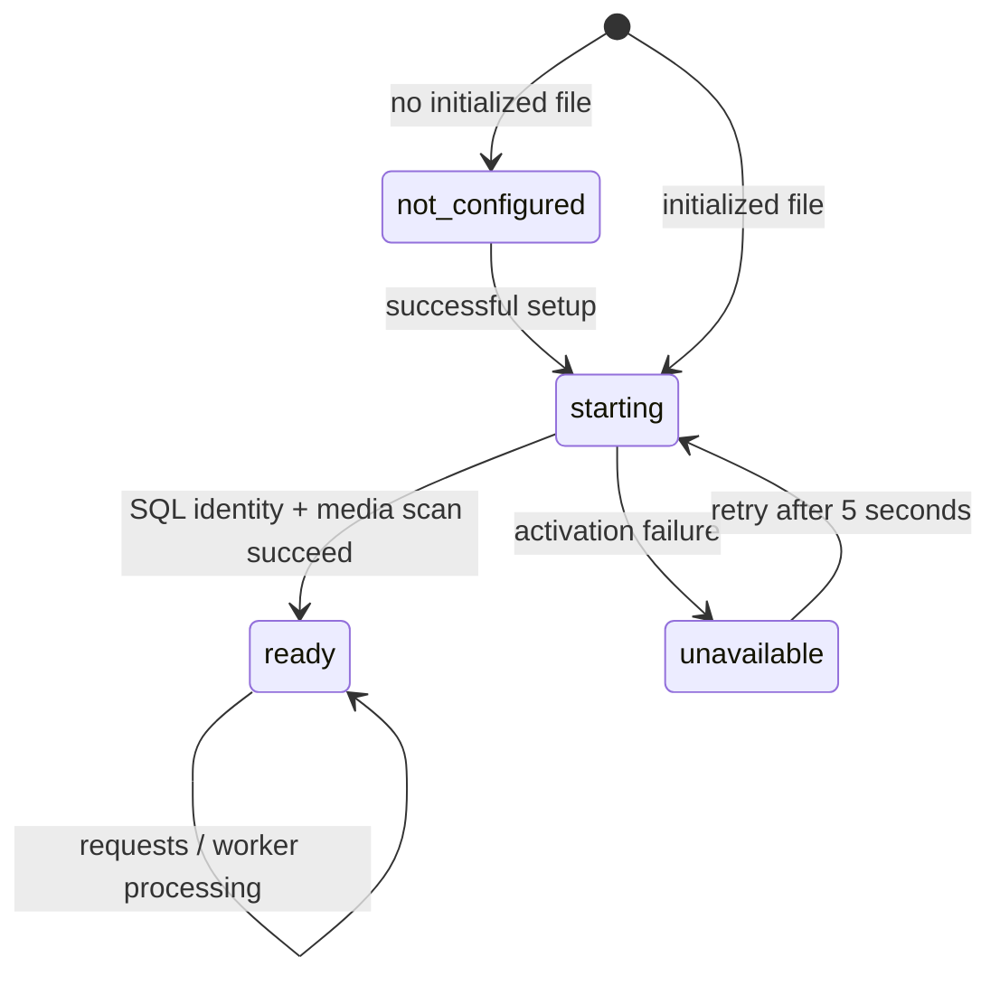

# Configuration, setup, and security

[Specification index](../../SPECS.md) · [Operations](operations.md)

## Configuration contract

Select YAML with `-config` or `GARMIN_CONFIG`, default `config.yaml` in the command's
working directory. File format is one YAML document with known fields only.
Missing files use defaults and remain uninitialized. Invalid YAML, unknown fields,
unsupported config version, or invalid application settings fail command startup.
There is no ENV setting that marks an installation initialized.

```yaml
version: 1
initialized: false
database:
  type: sqlite
  uri: dives.db
http:
  listen: 127.0.0.1:8080
  cookie_secure: true
  # public_url: https://dives.example.com
auth:
  session_lifetime: 24h
  idle_timeout: 2h
media:
  directory: assets
  max_upload_bytes: 17179869184
```

Setup adds `instance_id`, a random 32-character lowercase hex identifier, and
sets initialized true. `instance_id` is required for initialized config and must
be absent otherwise. It must match `admin_credentials.instance_id` in SQL. This
identity distinguishes a valid configured database from an empty/wrong database.
Preserve it during migrations and backups; it is not an API authentication secret.

Effective precedence is explicit flags > ENV > YAML > defaults. Canonical DB ENV
names win over legacy aliases even when both exist. Keep base file settings
separate from effective settings: saving configuration does not automatically
write ENV-only secrets into YAML. Explicitly submitting a URI in a setup/config
request does ask to persist that value, so omit managed properties to keep their
secrets entirely in ENV. ENV/flag-managed database values cannot be changed through
the API to a different effective value.

| YAML property | ENV | Default / validation |
| --- | --- | --- |
| database.type | GARMIN_DB_TYPE, alias GARMIN_OUTPUT_TYPE | sqlite; only sqlite/postgres |
| database.uri | GARMIN_DB_URI, alias GARMIN_OUTPUT_DSN | dives.db; at most 8192 bytes |
| http.listen | GARMIN_API_ADDR | 127.0.0.1:8080; nonempty |
| http.cookie_secure | GARMIN_COOKIE_SECURE | true; boolean |
| http.public_url | GARMIN_PUBLIC_URL | empty; HTTP(S) origin, no userinfo/query/fragment/path except `/` |
| auth.session_lifetime | GARMIN_SESSION_LIFETIME | 24h; 1 minute to 720 hours |
| auth.idle_timeout | GARMIN_SESSION_IDLE_TIMEOUT | 2h; at least 1 minute, no greater than lifetime |
| media.directory | GARMIN_ASSETS_DIR | assets; nonempty |
| media.max_upload_bytes | GARMIN_MEDIA_MAX_UPLOAD_BYTES | 16 GiB; positive integer, at most 2^60 |

Duration strings follow Go duration syntax, such as `2s`, `15s`, `2h`, `24h`;
there is no `1d` spelling. A compatible port must parse these deployed values.
Relative paths in configuration/ENV resolve against the YAML directory, including
relative `file:` SQLite URIs with preserved query options. Serve's relative
`-output-dsn` also resolves there; sync's explicit relative `-output-dsn` is passed
relative to its working directory. Use absolute command-line paths across roles.

SQLite requires persistent local storage: reject `:memory:`, `mode=memory`,
non-file URL schemes, and nonlocal file authorities. PostgreSQL accepts the
driver's standard URL or keyword DSN forms. The API only saves SQLite/PostgreSQL
settings; no live storage-driver selection or generic SQL compatibility is implied.

Configuration writes create a private temp file in the same directory, serialize
YAML, set mode 0600, fsync the file, close, and rename over the target. A directory
volume must therefore be writable; binding only the file is insufficient.
External YAML edits are loaded on restart, not watched live.

`GET /api/v1/config` is private. It reports active and pending database displays,
HTTP/auth/media settings, override sources, and `restart_required`. Database
display includes destination identity without password/connection options; it is
not the full URI. `PATCH /api/v1/config` accepts only a database type/URI object,
validates syntax, and saves pending settings. It does not test the target by
switching the running connection or copy any data. Other YAML properties are
currently managed by file/ENV/flags, not by this PATCH endpoint.

Every `/api/v1/admin/` route is also private for GET/HEAD. The missing-country
review list uses this boundary; public country catalogs and ordinary dive reads
remain available without login after setup.

## Setup and startup state machine

The HTTP listener exposes documentation, setup status/countries, `/healthz`, and
`/readyz` before a normal runtime is available. All normal APIs/assets are gated:
uninitialized returns 503 `not_configured`; initialized but unavailable returns
an availability code. OPTIONS returns 204 through common middleware. Normal GET
and HEAD become public when runtime is ready; mutation authentication is applied
after the initialization gate.



Availability states include `invalid_configuration`, `database_unavailable`,
`database_not_initialized`, `media_unavailable`, and exceptional
`initialization_failed`. Status reports configured and ready separately.
Readiness also pings the live SQL connection with a one-second timeout. A later
database outage changes readiness, not durable configured state. The existing
pool can reconnect when the database returns. No outage opens setup again.

First-run setup deliberately has **no setup token**, separate installation code,
or preexisting administrator password. POST `/api/v1/setup` has the same
cross-origin protection as login. It accepts at most 100 residence periods and
requires application/json. Process-level setup/config mutation is serialized;
another setup request returns 409. The SQL singleton prevents a second successful
administrator initialization on the same database.

Successful fresh setup:

1. Resolve requested database settings and validate all supplied countries/dates.
2. Open/migrate SQL; retain existing dives, FIT, media, and other records.
3. Validate/hash the administrator password outside the travel SQL transaction.
4. In one serialized SQL transaction, create singleton administrator credentials,
   reuse identical existing residence periods, reject overlapping periods, and
   require at least one resulting period. Reconcile trips.
5. Save initialized YAML with matching random instance identity, then commit SQL.
6. Activate the runtime asynchronously; respond 201 with configured true, ready
   false, state starting. Poll status and log in after readiness.

A config save failure rolls back the administrator/residence changes; migrations
already applied while opening SQL can remain. If SQL commit fails after file
save, attempt to restore the previous file. Failure to restore keeps setup closed
with initialization_failed rather than claiming a clean first-run state.
File plus SQL persistence is not a distributed transaction; crash recovery must
preserve these state checks.

If the YAML was lost but SQL already has credentials, setup must verify the
existing password and adopt its instance identity, not create/reset credentials.
Existing residence history is retained; supplied periods are not inserted during
adoption. An initialized file pointing to an uninitialized database does not
enter adoption/setup automatically. Repair configuration or migrate the data.

## Administrator credentials

There is one password-only administrator and no username. Password creation and
change require valid UTF-8, 15–128 Unicode code points, and significant whitespace
must be preserved. Reject all-whitespace and all-identical-character values.
There are no mandatory uppercase/digit/symbol composition classes.

Reference predictable-pattern rejection lowercases the candidate, then rejects
each base below if it is the whole password or removing all occurrences leaves
only `0123456789!@#$%^&*._- ` characters:

```text
password password1 1234567890 123456789 12345678 qwerty qwertyuiop
asdfghjkl letmein welcome admin administrator iloveyou changeme
correcthorsebatterystaple
```

This is the implemented local rule, not a remote breached-password service.
The whole request remains bounded, and verification rejects password inputs over
512 UTF-8 bytes before hashing. Hash with Argon2id v19, memory 65536 KiB, time 3,
parallelism 1, random 16-byte salt, 32-byte result. PHC format:
`$argon2id$v=19$m=65536,t=3,p=1$<unpadded-base64-salt>$<unpadded-base64-hash>`.
Compare hashes in constant time. Verification validates stored resource parameters
before allocating: memory 8192–262144 KiB, iterations 1–6, parallelism 1–4,
salt exactly 16 bytes and result exactly 32 bytes. Store only the hash in SQL.

Setup/login/password change share a per-process one-minute attempt limiter:
10 attempts per connection peer IP, 20 globally, bounded tracked peers (4096).
RemoteAddr is authoritative; forwarded-IP headers are ignored, so clients behind
one proxy generally share its bucket. Denial is 429 with Retry-After 60 seconds.
Hash/verify work is limited to two concurrent operations. Rate limits reset with
process restart and do not implement a cross-server account lockout.

## Session and request security

The reference uses SCS v2.9.0 with SQL-backed opaque sessions. Browser admin auth
does not use JWT. Login rotates the session token and stores `admin: true` and
the current integer `auth_version`. Tokens are cryptographically random; only
SHA-256 hex digests are persisted as the SQL lookup key. The raw token travels
only in the cookie, not API JSON or logs.

| Cookie property | Value |
| --- | --- |
| Name | __Host-garmindives_session when secure; garmindives_session for explicit insecure local mode |
| Secure | true by default |
| HttpOnly | true |
| SameSite | Strict |
| Path | / |
| Domain | unset, host-only |
| Persistence | persistent cookie bounded by absolute session lifetime |

Absolute lifetime defaults to 24 hours, idle timeout to 2 hours. SQL expiry is
checked on every session load. Expired rows are cleaned about every 10 minutes.
Auth/config and mutations load/save sessions; ordinary public GET/media reads
bypass session storage and do not refresh idle time. `expires_at` in auth JSON
is the absolute deadline, not a guarantee against earlier idle expiration.

Every authenticated request compares its stored version with SQL credentials.
Password change verifies current password, atomically updates hash with a version
compare-and-swap, increments auth_version, and deletes all session rows. Then it
destroys the current cookie. An old in-flight session written after deletion still
fails the version check. Logout deletes just the current session and clears its
cookie. Recovery CLI resets the hash and revokes all sessions after secure terminal
confirmation; it accepts no password argument and sends no recovery email.

Cross-origin protection wraps setup and all runtime mutations. Reference behavior:
GET/HEAD/OPTIONS pass; `Sec-Fetch-Site: same-origin` or `none` passes; other nonempty
values require an explicitly trusted Origin. With no fetch header, no Origin is
allowed for nonbrowser clients; otherwise Origin host must match request Host or
match the configured trusted public URL. Rejection is 403 `csrf_rejected`.
No wildcard CORS allowance is returned. Preserve origin/fetch headers at the proxy.
The configured public URL is an exact trusted origin, not a wildcard domain rule.

Common middleware sets `Cache-Control: no-store` and `X-Content-Type-Options: nosniff`;
asset handlers can supply their own validators/cache headers. Strict JSON decoders
reject unknown properties and trailing documents with a 512 KiB general body bound
(128 KiB for media metadata PATCH).
Authentication/setup/config JSON requires application/json; uploads require the
documented multipart form. Unauthenticated mutation requests fail before executing
their domain action. Session database failures fail closed with 503.

Session BLOB encoding in this release is Go Gob (`Deadline` plus value map), not
a portable public format. A replacement backend may invalidate all sessions and
require login on cutover, or deliberately migrate that representation. Preserve
credential hashes and instance identity; do not reset the administrator as a side
effect of changing session libraries. See [storage compatibility](storage.md#porting-and-compatibility).
