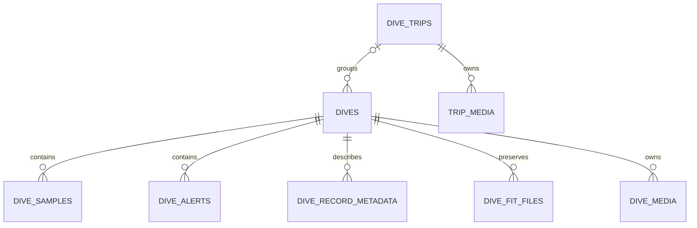

# Persistence model and compatibility

[Specification index](../../SPECS.md) · [Complete schema](schema.sqlite.sql)

## Data ownership

| Category | Durable location | Owner / refresh behavior |
| --- | --- | --- |
| Garmin source documents and imported summary | SQL dives | Sync owns them; targeted refresh fetches later edits |
| Original FIT files | SQL dive_fit_files BLOB/BYTEA | Retain exact file bytes; reusable offline |
| Decoded FIT and indexed samples/alerts | SQL | Derived, rebuildable from stored FIT |
| Notes rating/comment/highlights | SQL dives | Derived from retained source notes/description |
| Manual dive country, trip mode, cover | SQL dives | Local edits; survive Garmin imports |
| Residence history, trips, editorial metadata | SQL | Local edits plus deterministic grouping |
| Retained photos/videos | Filesystem assets | API upload or direct copy; eligible photos become JXL after verified conversion |
| Attachment metadata/editorial fields/favorites | SQL media tables | Index plus local edits; IDs survive indexing and photo conversion |
| JXL photo / JPEG video previews | Filesystem .thumbnails | Rebuildable cache keyed by bytes and options |
| JPEG photo fallbacks | Filesystem .fallbacks | Rebuildable cache generated on demand |
| Geocoding/translation results and queues | SQL | Persistent caches with leases/retries |
| Administrator hash and sessions | SQL | Private auth state |
| Application settings + initialization identity | YAML, ENV overrides | Shared by serve and sync |
| Garmin mobile/browser/bearer tokens | Private token-cache file | Sync adapter; separate from app administrator auth |

There is no JSON/YAML dive database or supported file-archive import/export mode.
JSON SQL columns preserve source data and decoded extensible structures.
The decoded fit_json cache and original FIT BLOBs are internal storage, never
embedded in JSON API responses. Original files can be downloaded only through
the authenticated administrator FIT endpoint; ordinary queries and graphs use
the indexed summaries/samples. Retain the cached data for future offline decoding.

## Relational schema

[schema.sqlite.sql](schema.sqlite.sql) was exported from a fresh, fully migrated
schema-13 database without user rows. It includes all columns, checks, foreign
keys, explicit indexes, migration markers, and the initial pacing singleton. It
is a reference snapshot, **not** a script to apply over an existing installation.
Do not run it to upgrade a database or to create fake setup credentials.

| Table | Key | Purpose / relationship |
| --- | --- | --- |
| schema_migrations | version | Transactionally applied migration versions |
| dives | activity ID | Imported summary, source JSON, decoded FIT, local overrides and membership |
| dive_record_metadata | dive_id + position | Indexed graph column keys |
| dive_samples | dive_id + sample_index | Profile points; nullable optional metrics and internal-only raw record JSON |
| dive_alerts | dive_id + alert_index | Recognized alerts / raw source data |
| dive_fit_files | dive_id + file_index | Exact original FIT bytes, filename, size, SHA-256 |
| dive_media | random ID | Dive-owned attachments; unique dive_id + filename |
| resync_jobs | random ID | Persistent administrator metadata-refresh jobs, one active job |
| resync_items | job_id + activity_id | Per-target status/errors; no FIT payloads |
| pending_media | random ID / unique filename | Private inbox metadata, candidates and assignment receipts |
| home_countries | random ID | Inclusive dated residence; overlap enforced by serialized application logic |
| dive_trips | random ID | Editorial trip, override flags, dates, soft deletion, anchor dive |
| trip_media | random ID | Trip-owned attachments; unique trip_id + filename |
| country_lookup_cache | lookup_key | Coordinate cache and queue state |
| country_lookup_pacing | id = 1 | Database-wide next country request time |
| translation_cache | source_hash | Content/profile cache, aligned partial results, queue and lease state |
| admin_credentials | id = 1 | Instance ID, PHC password hash, auth_version, initialized timestamp |
| admin_sessions | token_hash | Encoded session, expiry in Unix milliseconds |



Child dive records and media cascade on physical dive deletion; there is currently
no public dive DELETE endpoint. Covers reference their corresponding media table
with ON DELETE SET NULL; application logic also verifies same-owner photo kind.
Trip anchors point to dives with ON DELETE SET NULL. SQL foreign keys alone do
not enforce country validity, same-owner covers, residence overlap, or membership
mode semantics. A port must enforce those in domain transactions.

IDs for local entities are 16 random bytes encoded as 32 lowercase hexadecimal
characters, not numeric sequences. Trip route validation accepts only that form.
Preserve these IDs on migration. `dive_trips.country_override` is a boolean flag;
`dives.country_override` is a nullable country-code string. Confusing these two
loses the distinction between detected and user-selected values.

Timestamps have several intentional representations: imported local starts remain
source strings; local/residence/trip dates are date-only text; editorial timestamps
are UTC RFC3339Nano text; worker lease/retry and session expiry times are Unix
milliseconds; original FIT stored_at/downloaded_at/migration timestamps use SQL
TIMESTAMP defaults. Do not interpret file modification nanoseconds as milliseconds.
Booleans are stored as integer 0/1 for both SQL dialects. JSON is stored as TEXT;
SQL JSON literal `"null"` is distinct from SQL NULL. `fit_json = 'null'` marks a
missing FIT import, not an empty samples table.

SQLite uses foreign_keys=ON on its connection and a single open connection in
the reference. PostgreSQL uses BYTEA instead of BLOB for FIT/session data; the
other shared tables retain their documented SQL types and integer booleans.
PostgreSQL creation must order the cyclic dive/trip/media relationships by creating
tables before adding their cover/membership foreign keys. The SQLite snapshot
permits forward references and is not directly PostgreSQL executable.

## Transactions and concurrency

Migrations run one version per transaction, marking that version only after its
DDL/backfill succeeds. A database newer than schema 13 is rejected. Fresh databases
apply every version; upgrades apply only missing versions. Concurrent deployment
should avoid racing multiple migration processes; the reference does not expose a
separate production migrate command or a general distributed migration coordinator.

| Version | Change |
| --- | --- |
| 1 | Dive/source summaries, metadata, samples, alerts |
| 2 | Local date backfill and list indexes |
| 3 | Decoded FIT JSON |
| 4 | Original FIT BLOB/BYTEA table; backfill retained base64 bytes in batches of 16 |
| 5 | Dive attachment metadata |
| 6 | Dive cover photo |
| 7 | Attachment description |
| 8 | Structured rating/comment/highlights; local backfill in batches of 100 |
| 9 | Translation cache and worker state |
| 10 | Countries, residence, trips, trip media, favorites, geocoding queue/pacing |
| 11 | Single administrator and SQL sessions |
| 12 | Pending media inbox/assignment receipts; capture_json on both media owner tables |
| 13 | Administrator data-only resync jobs and target results, active-job uniqueness |

FIT migration rejects invalid/empty/oversized retained bytes and rolls back that
migration. FIT readback verifies size and SHA-256 before decoding. Keep the original
file index ordering. Existing file rows are not overwritten by repeated imports.

Sync stages network results before opening its save transaction. Insert new dive
rows and children together; on duplicate ID, ordinary sync only enriches absent
FIT and null summary gaps. Targeted refresh updates imported columns without
touching covers, country overrides, or manual/excluded membership. Replace profile
children only when a replacement profile exists. Reconcile country/trip state
before committing. A failed batch must not leave half-imported dives.

Related residence/country/trip/auth updates use the travel transaction serializer:
SQLite's writer serialization, and PostgreSQL transaction advisory lock 1734439538.
Acquire before overlap/grouping/version checks. Do not hold this lock during
Garmin, DeepL, geocoding, or FFmpeg work. Media mutations have an additional
process-local gate, not a cross-container media lock. Default deployment has one
serve writer; parallel serve processes must not be assumed safe for every file
operation just because SQL supports concurrent sessions.

Workers claim through atomic UPDATE/RETURNING and owner leases. Completion must
match lease owner. Country pacing is reserved transactionally before provider
calls. Translation pacing is per process; leases protect jobs, not aggregate
provider account throughput. Public API reads never invoke an external enrichment
provider synchronously.

## Filesystem layout

```text
/config/config.yaml
/data/dives.db                 # SQLite deployment; PostgreSQL uses its own volume
/assets/
  pending/<original photo or video>
  <activity-id>/<retained filename>
  trips/<trip-id>/<retained filename>
  .thumbnails/<versioned-key>.jxl  # photos
  .thumbnails/<versioned-key>.jpg  # videos
  .fallbacks/<versioned-key>.jpg
  .photo-jobs/<media-id>.json     # unfinished filesystem/SQL publication
  .uploads/<temporary-id>
```

Only canonical positive decimal activity directories identify dives. Filenames
must be nonempty, at most 255 UTF-8 bytes, have no slash/backslash/control character,
and not start with a dot. Files must be nonempty regular files; no recursive
subdirectories or symlink imports. Supported extensions/kinds are enumerated in
[operations](operations.md#media-support). Content type is inferred from extension,
not a promise that the stored file has been successfully decoded.

Photo processing uses the existing `probe_json` object, with a
`garmindives_photo` member containing `version: 1`, optional `source_filename`,
`source_sha256`, `projection`, and `projection_format`. The source fields identify
the pre-conversion file and allow its original filename to resolve to the existing
media ID during imports or duplicate-upload checks. Projection hints survive
conversion even when the new image container does not retain source metadata.
The row's filename, dimensions, size, checksum and modified time describe the
retained file. Processing does not require a new SQL schema version.
HEIC/HEIF processing additionally records `heif_decoder_version: 1`. Earlier HEIC
conversions without that marker require the source to be reintroduced. Do not
increment the overall photo profile or re-encode unrelated completed photos for
a HEIF decoder change. Small retained HEICs receive regenerated previews while
preserving their original bytes/checksum. Completed HEIF thumbnails include a
`heif-primary-v1` key component; direct HEIC JPEG fallbacks similarly prefix their
source checksum to avoid serving old tile-only cached images.

Videos similarly use `garmindives_video` with `version: 1`, source filename/checksum
and retained projection/format/stereo hints. This uses the existing probe_json and
requires no SQL migration. See [video publication](video-processing.md#publication-recovery-and-operation).

Recovery journals record owner, media ID, source/target paths and checksums,
optional kind (`video`, otherwise legacy photo),
thumbnail key, and any backup/obsolete master. Journals and publication directories
are synchronized before committing metadata or deleting source bytes. A scan
finishes cleanup when SQL identifies the committed master and thumbnail; otherwise
it rolls back the publication and restores its backup. Changed source bytes are
retained. Hidden processing directories are not exposed as asset routes. Keep
pending journals/backups with the assets when moving an interrupted installation.

Assets URLs require indexed metadata and a live owner. Removing SQL media rows
does not expose leftover originals through a general file server. Deleting a trip
is soft deletion: rows/files remain for retention, but its original/thumbnail
routes stop serving them. A filesystem move between owners is a remove/new import,
not an API-supported media reassignment operation.

## Porting and compatibility

Two distinct targets must be explicit when rebuilding in Rust or another language:

1. **Behavioral replacement:** implement the same API, concepts, algorithms, units,
   auth behavior, and acceptance cases; the internal schema/libraries may differ.
2. **Existing-installation replacement:** additionally import every durable user
   value, original FIT byte, attachment ID/filename, trip ID/override, residence,
   translation result, country cache, and initialization identity. Preserve PHC
   hashes so the existing password works. Plan any changed schema/cache formats.

Keeping active browser sessions across a language migration requires decoding the
Go Gob SCS payload. It is acceptable to explicitly revoke sessions at cutover and
require login, preserving credentials. Garmin token-cache formats are adapter
specific; use the pinned adapter's Tokens definition or ask operators to supply
their key again. Never confuse Garmin token auth with application admin sessions.
Exact translation/thumbnail cache key compatibility can be implemented or migrated;
do not discard paid ready translations just to change serialization conventions.

The documentation specifies this application's integration responsibilities, not
the entire FIT binary standard, FFmpeg codecs, or Garmin's legacy OAuth/SSO
protocol. A port must use a conforming FIT decoder with CRC/components/developer
field support, a compatible media processor, and a Garmin adapter. The reference
dependencies are muktihari/fit v0.27.3 and go-garminconnect v0.2.0 (see go.mod).
Their pinned implementation/tests provide legacy adapter and binary-format details;
port/reuse that behavior rather than inventing an abbreviated protocol. Personal
API paths and content mapping are documented in the backend guide. Future upstream
API changes must be verified separately from this baseline.

Start porting with schema/config bootstrap and public reads, then auth and edits,
then sync/FIT, then media and enrichment. Use mocked providers and disposable
databases for the [acceptance scenarios](acceptance.md), and compare response
structure to OpenAPI. Production data migration is a separate reviewed operation.
